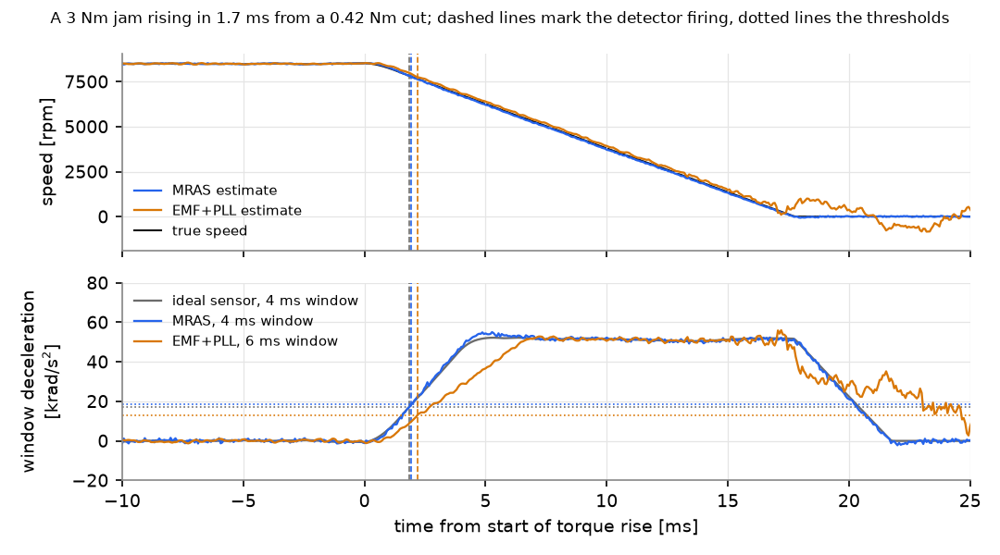
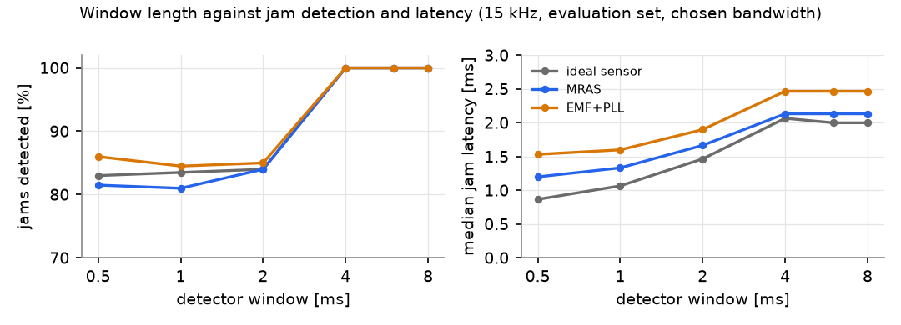
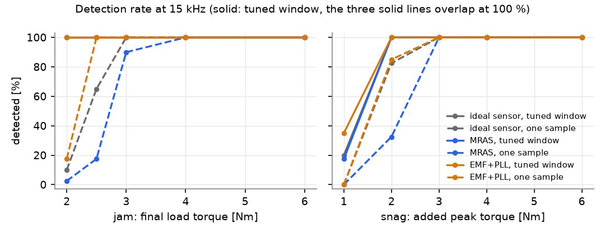
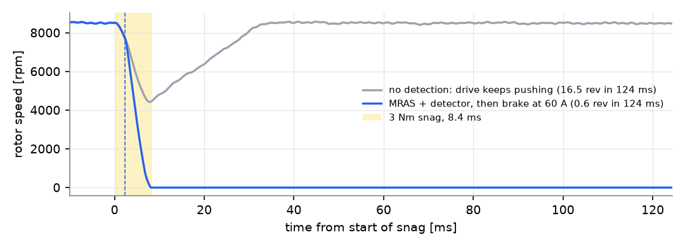

# Detecting a chain jam from a sensorless motor speed estimate

This project asks how fast a sensorless motor drive can notice that a saw
chain has jammed, using only its own speed estimate, without tripping on hard
but normal cutting. I also wanted to know what that check costs on a
Cortex-M4.

Everything is simulated. The motor is a 1.2 kW surface PMSM with 14 poles,
taken from a public KTH master thesis about a battery chainsaw motor (Westin,
2016). The loads are synthetic because I could not find any recorded chainsaw
load data, so the numbers compare methods. They are not field results.

The repository has a closed loop simulation in Python (motor, sampled FOC with
one period of computation delay, current noise and ADC rounding), two
sensorless observers (the MRAS from the thesis and a back EMF observer with a
PLL) and a detector that looks at the mean deceleration over a short window.
The observers and the detector are also written in C with float32. The C code
is checked sample by sample against the Python version, built for a Cortex-M4F
and run on QEMU to count instructions. GitHub Actions runs all of it.



*A jam that rises to 3 Nm in 1.7 ms from a 0.42 Nm cut. Top: the true rotor
speed and the two sensorless estimates. Bottom: the windowed deceleration each
detector sees, its threshold (dotted) and the moment it fires (dashed). All
three fire 1.9 to 2.2 ms after the torque starts to rise. Near standstill the
back EMF estimate wanders, which is why the detection has to happen well
before that.*

## Results

At 15 kHz, with 200 jams (final load torque 2 to 6 Nm) and 160 s of normal
cutting that was not used for tuning:

| speed source | threshold on a single sample | threshold on a window |
|---|---|---|
| ideal speed sensor | 75 % of jams, false alarm in 2 runs | 100 %, median 2.1 ms, 4 ms window |
| MRAS | 62 % of jams | 100 %, median 2.1 ms, 4 ms window |
| back EMF observer + PLL | 84 % of jams | 100 %, median 2.5 ms, 6 ms window |

Latency is measured from the moment the load torque starts to rise. The
windowed detector had no false alarms in these three rows.

The single sample threshold fails for a simple reason. A 1.4 Nm load step,
which the motor can carry, slows the bare rotor at about 45 krad/s² during the
first millisecond, until the speed loop catches up. A 2 Nm jam slows it at only
about 17 krad/s², but it keeps doing so. If the threshold is high enough to
ignore the load step, it misses the jam.

Taking the mean deceleration over 4 to 8 ms solves this. The windowed detector
caught every jam of 2 Nm and above, at all three sampling rates and with all
three speed sources. It also caught every snag (a short torque pulse) of 2 Nm
and above. Median latency was 2.0 to 2.6 ms and the 95th percentile 3.9 to
4.7 ms.

The sensorless observers were only a little slower than an ideal speed sensor:
the MRAS by 0.05 to 0.1 ms in median latency, the back EMF observer with PLL
by 0.4 to 0.6 ms. Keep in mind that both observers here know R, L and the flux
exactly and start converged. Sampling at 10, 15 or 20 kHz made little
difference once the observer bandwidth and the window were tuned for each rate.

On a Cortex-M4F the observer and the detector together take 340 to 364
instructions per control period, roughly 480 to 540 cycles. A 100 MHz core
running the loop at 15 kHz has 6,667 cycles per period, so this is about 8 %
of it. The library is 1.5 KB of code and does not use libm. RAM use is 20 or
28 bytes of observer state plus about 1 KB for the detector's ring buffer of
256 speed samples.

There was one false alarm. The back EMF observer at 10 kHz with an 8 ms window
tripped once in its 40 held out runs (160 s). The threshold is set to 1.1
times the largest deceleration seen in 160 s of tuning data, and that is not a
guarantee. A threshold for a real product would need hours of recorded
cutting.

## What is simulated

### Motor and drive

| | value | source |
|---|---|---|
| poles, slots | 14, 12 | Westin 2016, Table 1.1 |
| rated power, torque, speed | 1.2 kW, 1.5 Nm, 8500 rpm | Table 1.1 |
| DC link, max current | 30 V, 60 A | Table 1.1 |
| R, L (Ld = Lq) | 8.7 mΩ, 19 µH | Appendix A |
| PM flux linkage | 2.37 mVs/rad (from Ke = 2.13·√2 V/krpm) | Appendix A |
| rotor inertia, viscous damping | 3.0e-5 kg m², 5e-5 Nm s/rad | Appendix A |

Kt times Imax is 0.0249 Nm/A × 60 A = 1.49 Nm, which matches the rated
torque, so the flux conversion from the thesis is consistent. At 8500 rpm the
electrical frequency is 992 Hz, which leaves only 10 to 20 samples per
electrical period at 10 to 20 kHz.

The current controllers are series PI controllers with Kp = L·BWc and
Ki = R/L as in the thesis (eq. 4.1 and 4.2), with BWc = 2π·fs/20, plus back
EMF decoupling. The speed controller is a PI with an 85 Hz crossover. That
gives 464 rpm of droop under a 1 Nm step, close to the 450 rpm the thesis
reports. I could not use the speed gains printed in the thesis appendix. Run
as printed they give 19 % overshoot instead of 2.9 %, and the speed goes
through zero under the 1 Nm load (see `scripts/check_appendix_a.py`).

Currents are sampled at the start of each period and the new voltage is
applied one period later, so the inverse Park transform uses
θ̂ + 1.5·ω̂·Ts. The inverter is an average model limited to the circle inside
the SVM hexagon (30/√3 V), with no dead time and no switching ripple. Phase
currents a and b get 0.2 A of noise (1σ) and go through a 12 bit ADC over
±80 A. Both of those numbers are my own guesses. The plant is integrated with
RK4, using 8 substeps per control period.

### Loads

All loads are synthetic. They act like friction, T·tanh(ω / 2 rad/s), so a
large load stalls the rotor instead of turning it backwards.

Normal cutting idles at 0.05 Nm and then cuts at a random level between 0.3
and 1.4 Nm. Most cuts ramp in over 20 to 150 ms, but 30 % are hard entries
that rise in 0.5 to 2 ms, and those are what make the problem hard. During a
cut there is low pass filtered noise (10 % of the level), knots (half sine
bumps of 0.1 to 0.5 Nm lasting 2 to 20 ms, three per second on average) and a
ripple locked to the rotor angle at 3.5 cycles per revolution. The total stays
under the rated 1.5 Nm, so the motor can always carry it.

A jam starts from a steady cut. The load rises in 0.5 to 3 ms to 2, 2.5, 3, 4
or 6 Nm and stays there. That is more than the motor can deliver, so the rotor
stalls. A snag is a half sine pulse of 1, 2, 3, 4 or 6 Nm lasting 3 to 15 ms on
top of a steady cut. It is a rough stand in for the chain catching.

The speed reference stays at 8500 rpm, as if the trigger were held. I left out
startup and trigger release. On a real tool the detector would be switched off,
or compared against the speed command, while the speed is changed on purpose.

## Observers

Both observers run once per period in the estimated rotor frame and use the
same discretisation: the stator current model is stepped exactly over one
period, with speed and voltage held constant. At rated speed the rotor turns
18 to 36 electrical degrees per sample. A forward Euler step of the same model
has a pole at |λ| = 1.03, 1.05 and 1.14 for 20, 15 and 10 kHz. That is outside
the unit circle, so Euler is not an option here (`tests/test_core.py` checks
this).

The MRAS follows the thesis (eq. 4.7 to 4.9). The motor is the reference
model, the dq current model with the estimated speed is the adjustable model,
and a PI law on the Popov error signal moves the speed estimate. I take the PI
gains from the linearised loop, s² + (R/L + G·Kp)s + G·Ki with G = (ψ/L)²,
placed at the chosen bandwidth.

The second observer is a Luenberger observer of the current model that treats
the back EMF as a constant disturbance in the estimated frame. Both error poles
sit at the observer bandwidth, which is 4 times the PLL bandwidth. A type 2 PLL
then drives the γ component of the estimated EMF to zero, and the PLL
integrator is the speed estimate.

## Detector and tuning

The detector fires when the mean deceleration over the last N samples,
(ω̂[k-N] - ω̂[k]) / (N·Ts), is above a threshold A while ω̂ is above 20 % of
rated speed. With N = 1 this is a plain threshold on deceleration.

Every combination of speed source, sampling rate, observer bandwidth (200, 400
and 800 Hz) and window (one sample, 0.5, 1, 2, 4, 6 and 8 ms) is tuned the same
way. The threshold is 1.1 times the largest windowed deceleration in set A,
which is 40 runs of 4 s of normal cutting. Then the bandwidth and window with
the highest detection rate on set T (10 events per severity) are picked, with
median latency as the tie breaker. The single sample detector gets its own best
bandwidth in the same way. Finally I count false alarms on set B (another 40
runs of 4 s) and detections on set E (40 events per severity, 400 in total).
Sets B and E are never used for tuning.

A jam only counts as detected if the detector fires after it starts and before
the true speed drops below 20 % of rated. Below that a back EMF estimate cannot
be trusted, so a later detection would not help on real hardware. A snag counts
if the detector fires before the end of the pulse plus 5 ms. Scoring is done
offline on the logged speed estimate. That is exact, because a run is identical
up to the moment the detector fires.

## More results



*With windows of 0.5 to 2 ms, 28 to 37 of the 40 jams at 2 Nm are missed,
while nearly every heavier jam is caught. Once the window is longer than the
transient after a hard normal load step, the threshold can go below the
deceleration of a slow jam. Each longer window adds a fraction of a
millisecond of latency.*



*Solid lines are the tuned windowed detector, dashed lines the single sample
threshold. Snags of 1 Nm are mostly missed by every method. They sit inside
the range of normal cutting, since the motor itself can deliver 1.5 Nm, so not
tripping on them may well be the right answer.*

All sampling rates, scored on the held out sets:

| fs | speed source | bandwidth | window | threshold [krad/s²] | false alarms (40 runs, 160 s) | jams detected | median and p95 latency [ms] | snags of 2 Nm and above detected |
|---|---|---|---|---|---|---|---|---|
| 10 kHz | ideal sensor | none | 6 ms | 11.7 | 0 | 200/200 | 2.0, 3.9 | 160/160 |
| 10 kHz | MRAS | 400 Hz | 6 ms | 12.8 | 0 | 200/200 | 2.1, 4.1 | 160/160 |
| 10 kHz | EMF + PLL | 800 Hz | 8 ms | 10.8 | 1 | 200/200 | 2.6, 4.7 | 160/160 |
| 15 kHz | ideal sensor | none | 4 ms | 17.0 | 0 | 200/200 | 2.1, 3.9 | 160/160 |
| 15 kHz | MRAS | 400 Hz | 4 ms | 18.6 | 0 | 200/200 | 2.1, 4.2 | 160/160 |
| 15 kHz | EMF + PLL | 800 Hz | 6 ms | 13.0 | 0 | 200/200 | 2.5, 4.7 | 160/160 |
| 20 kHz | ideal sensor | none | 8 ms | 8.5 | 0 | 200/200 | 2.0, 4.0 | 160/160 |
| 20 kHz | MRAS | 400 Hz | 6 ms | 12.0 | 0 | 200/200 | 2.0, 4.1 | 160/160 |
| 20 kHz | EMF + PLL | 800 Hz | 4 ms | 18.8 | 0 | 200/200 | 2.4, 4.6 | 160/160 |

With the single sample threshold, 105 to 167 of the 200 jams are caught. The
back EMF observer at 20 kHz is the exception. It catches all 200, but late:
the 95th percentile is 29 ms, mostly close to stall. The full output,
including every candidate tried during tuning, is in
[results/summary.md](results/summary.md) and
[results/benchmark.json](results/benchmark.json).

### Braking after detection



*This one is only an example and is not part of the benchmark. After the
detector fires, the controller switches to a braking current of 60 A on the q
axis using the MRAS angle, and goes to zero current below 1000 rpm, where the
angle estimate is no longer reliable. Without detection the speed loop drives
the chain straight back into the cut.*

## C implementation

The code that would run on the controller is in `c/src`: `jd_mras.c`,
`jd_emf.c`, `jd_detector.c` and `jd_math.c`. It uses float32 only, keeps its
state in structs owned by the caller and never allocates. It does not need
libm. `jd_sincos` is a range reduction in the style of Cody and Waite plus
short polynomials, with a largest error of 8.5e-8 on [-4, 4], and the square
root is the FPU instruction. The library builds with `-Wall -Wextra -Wpedantic
-Wconversion -Wdouble-promotion -Wshadow -Werror`. The constant exp(-R·Ts/L)
is computed off target and passed in, as a config generator would do.

`scripts/export_vectors.py` saves closed loop runs of the Python reference (a
3 Nm jam and a 1.2 Nm hard step, for both observers) with every sampled
current, every applied voltage and the reference outputs.
`c/test/test_vectors.c` feeds the same inputs to the C code. The largest angle
difference is 1.0e-5 rad and the largest speed difference 0.006 rad/s, against
6231 rad/s electrical, and the detector fires on the same sample in all four
files. A pytest test replays the stored inputs through the Python code, so the
stored outputs cannot drift away from it.

### Cost on a Cortex-M4F

`scripts/count_instructions.py` builds the library with arm-none-eabi-gcc
(`-mcpu=cortex-m4 -mfpu=fpv4-sp-d16 -mfloat-abi=hard -O2`) for the mps2-an386
machine in QEMU. It calls each function 200 times on recorded inputs, with one
instruction per translation block and exec logging, and counts the
instructions executed inside the `jd_` functions.

| function | instructions per call | rough cycles per call |
|---|---|---|
| `jd_mras_step` | 306 | 428 |
| `jd_emf_step` | 330 | 486 |
| `jd_det_step` | 34 | 51 |

QEMU is not cycle accurate. For the cycle column I weighted each executed
instruction with the Cortex-M4 TRM timings (loads and stores 2, VDIV and VSQRT
14, VMLA and VFMA 3, branches 2, everything else 1), assuming zero wait states
and ignoring pipelining. Read it as an order of magnitude, not a measurement.
Flash wait states and interrupt entry on a real part would add to it.

## Limits, and what did not work

The speed gains in the thesis appendix do not give the thesis' own speed
response, so I tuned the speed loop myself against the reported droop. Forward
Euler is unstable for both observers at these sampling rates. A fixed margin
over a finite tuning set does not guarantee zero false alarms, and one of the
nine tuned configurations did trip once on held out data. I also expected the
detection rate to improve gradually with the window length, but with these
loads it stays flat from 0.5 to 2 ms and jumps at 4 ms.

Several things are not modelled at all: dead time and PWM ripple, battery sag
and the limit on regenerative current while braking, stator resistance rising
with temperature (the thesis allows for +55 %), startup, low speed, trigger
release, and real load torque recordings. Only the rotor inertia is known.
Chain and sprocket inertia would lower every deceleration and move every
threshold. The snag is a torque pulse on the rotor and not a model of
kickback, which also involves the saw body rotating towards the user.

## Reproduce

```bash
python3.12 -m venv .venv && .venv/bin/pip install -e ".[test]"
PYTHON=.venv/bin/python ./run_all.sh
```

`run_all.sh` runs the Python tests, regenerates the C test vectors, builds and
runs the C tests, runs the benchmark (about a minute on 8 cores), draws the
figures and runs the Cortex-M4 count. You need cmake and a C compiler, and for
the last step arm-none-eabi-gcc and qemu-system-arm. CI runs the same steps on
Ubuntu (`.github/workflows/ci.yml`).

## Related work

I. Westin, *Sensorless Control of a PMSM: Evaluation of Different Speed and
Position Estimation Methods*, MSc thesis, KTH, 2016 (diva2:1032918). The motor
data, the MRAS and the test cases come from here. The thesis left the EKF out
because of its expected computational load, without measuring it.

US 12,103,201 B2 (granted 2024) describes kickback mitigation on a handheld
power cutter. The disc speed comes from a rotor angle estimated from the motor
currents, and a deceleration above a threshold, given as 5,000 to 35,000
rad/s², starts electromagnetic braking. This repository looks at the detection
side of the same idea on a smaller motor, mainly at how to set the threshold
and the window so that normal cutting does not trip it.

## Next

Next I want to add an extended Kalman filter as a third observer, with the
same C port and instruction count, and rerun everything with stator resistance
+50 %, two and four times the inertia, and dead time. I would also like to try
combining the deceleration rule with the speed controller sitting at its
current limit.

## License

MIT, see [LICENSE](LICENSE).
